# Лабораторная работа № 2. Управление системой и пользователями

Студент: Калантаров Т.А.
Группа: ИС-25

## Цель работы

Научиться создавать пользователей и группы, настраивать права доступа к каталогам, изучить основные команды управления пользователями, следить за активностью пользователей и автоматизировать создание пользователей с помощью bash-скрипта.

## Используемые средства

| Компонент | Версия |
|---|---|
| Гостевая ОС | Debian 13 «Trixie» |
| Подключение | SSH с основного компьютера: `ssh -p 2222 vboxuser@127.0.0.1` |

Все команды выполнялись по SSH от имени root (`sudo -i`).

---

## Задание 1. Создание пользователей и групп

Созданы пользователи `admin`, `user1`, `user2` (`-m` — создать домашний каталог, `-s` — указать оболочку) и заданы пароли:

```bash
useradd -m -s /bin/bash admin
useradd -m -s /bin/bash user1
useradd -m -s /bin/bash user2
passwd admin
passwd user1
passwd user2
```

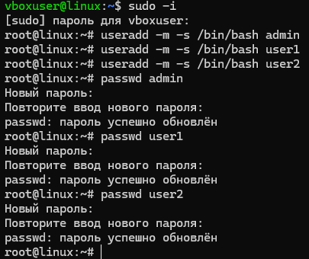

Созданы группы `developers` и `testers`. Пользователь `admin` добавлен в обе группы, `user1` — в `developers`, `user2` — в `testers` (ключ `-a` добавляет в группу, не удаляя из остальных, `-G` — список групп):

```bash
groupadd developers
groupadd testers
usermod -aG developers admin
usermod -aG testers admin
usermod -aG developers user1
usermod -aG testers user2
id admin; id user1; id user2
getent group developers testers
```

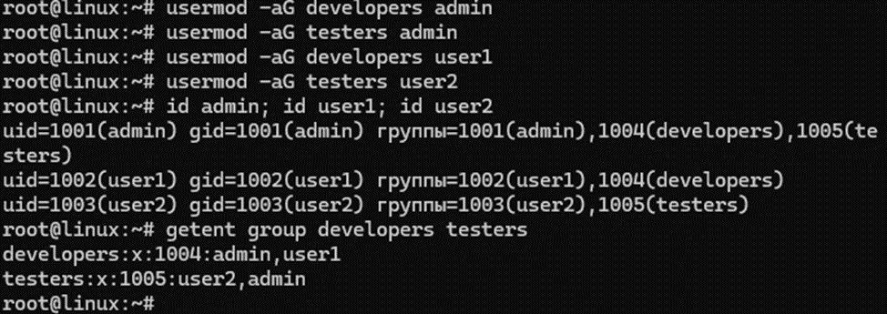

---

## Задание 2. Настройка прав доступа

Созданы каталоги и настроены владельцы и права:

```bash
mkdir -p /home/admin/data /home/admin/logs

chown admin:admin /home/admin/data
chmod 755 /home/admin/data

chown admin:developers /home/admin/logs
chmod 770 /home/admin/logs

chmod 711 /home/admin
ls -ld /home/admin /home/admin/data /home/admin/logs
```

- `data` — `755` (`rwxr-xr-x`): владелец `admin` может создавать и изменять файлы, остальные пользователи только читают;
- `logs` — `770` (`rwxrwx---`): читать и писать могут `admin` и группа `developers`, остальные не имеют доступа;
- `/home/admin` — `711` (`rwx--x--x`): в Debian домашний каталог по умолчанию закрыт для других пользователей, поэтому без права входа (`x`) `user1` не смог бы попасть в `logs`.

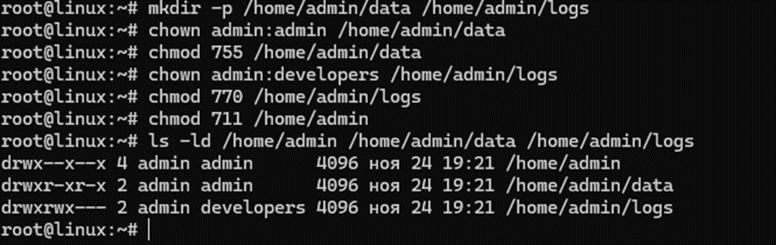

Проверка прав:

```bash
sudo -u user1 touch /home/admin/logs/test.log   # получилось
sudo -u user2 touch /home/admin/logs/t2.log     # Отказано в доступе
sudo -u user1 touch /home/admin/data/f.txt      # Отказано в доступе
sudo -u admin touch /home/admin/data/f.txt      # получилось
```

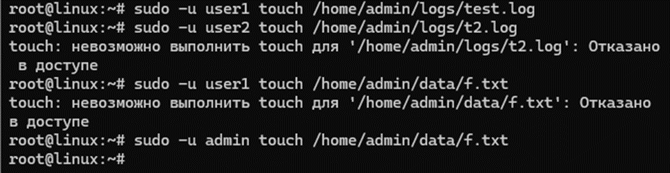

---

## Задание 3. Команды для работы с пользователями

| Команда | Что делает | Пример |
|---|---|---|
| `useradd` | создаёт пользователя | `useradd -m -s /bin/bash user1` |
| `usermod` | изменяет пользователя (группы, оболочку, блокировка) | `usermod -aG developers user1` |
| `groupadd` | создаёт группу | `groupadd developers` |
| `passwd` | меняет пароль, показывает и меняет статус учётной записи | `passwd user1` |
| `chown` | меняет владельца и группу файла или каталога | `chown admin:developers logs` |
| `chmod` | меняет права доступа (r=4, w=2, x=1) | `chmod 770 logs` |

Смена пароля пользователя `user1`:

```bash
passwd user1
```

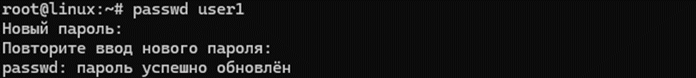

Блокировка учётной записи `user2`:

```bash
usermod -L user2
passwd -S user2
grep user2 /etc/shadow
```

`passwd -S` показывает статус `L` — учётная запись заблокирована. В файле `/etc/shadow` перед хешем пароля появился знак `!`, поэтому вход по паролю невозможен. Для разблокировки используется `usermod -U user2`.

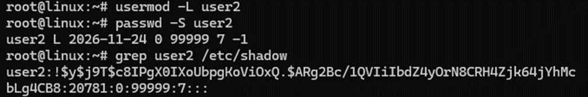

---

## Задание 4. Мониторинг активности пользователей

С основного компьютера выполнен вход по SSH от имени `user1`, затем выполнены команды:

```bash
ssh -p 2222 user1@127.0.0.1
who
w
last -n 10
```

| Команда | Что показывает | Примеры использования |
|---|---|---|
| `who` | кто сейчас вошёл в систему: имя, терминал, время входа, адрес | `who`, `who -b` (время загрузки системы) |
| `w` | то же, что `who`, плюс время работы системы, нагрузку (load average) и текущую команду каждого пользователя | `w`, `w user1` |
| `last` | история входов и выходов из файла `/var/log/wtmp`, перезагрузки системы | `last -n 10`, `last user1`, `last reboot` |

Столбцы вывода `w`: `USER` — пользователь, `TTY` — терминал (`pts/0` — SSH-сессия, `tty1` — консоль), `FROM` — адрес, откуда выполнен вход (при подключении через NAT это `10.0.2.2` — основной компьютер), `LOGIN@` — время входа, `IDLE` — время бездействия, `WHAT` — выполняемая команда.

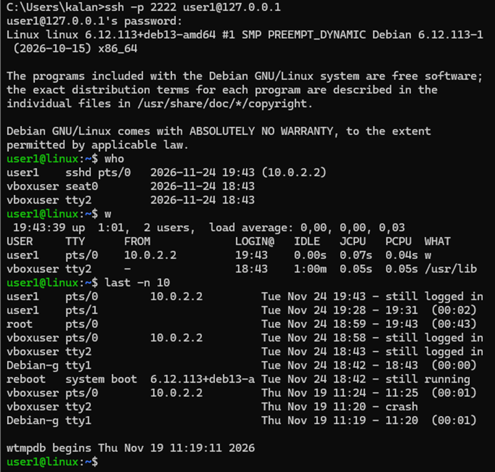

---

## Задание 5. Скрипт для создания пользователей

### 5.1. Подготовка текстового файла со списком пользователей

В каталоге `~/bash_script` создан текстовый файл `create_users.txt` со списком пользователей и групп в формате `пользователь:группа`:

```bash
mkdir -p ~/bash_script && cd ~/bash_script
nano create_users.txt
cat create_users.txt
```

Содержимое файла:

```
ivanov:developers
petrov:testers
sidorova:developers
```

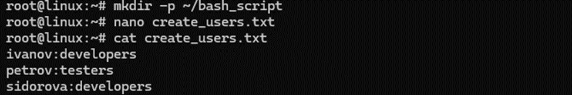

### 5.2. Создание и запуск bash-скрипта

Создан скрипт `create_user.sh`, который запрашивает имя входного файла, проверяет его существование, построчно считывает пары `username:group`, создаёт группу (если она отсутствует, с флагом `-f`) и создаёт пользователя с домашним каталогом и добавлением в указанную группу (если пользователь ещё не существует):

```bash
#!/bin/bash

echo "Введите имя файла. Пример: create_users.txt"
read -r fileName

if [ ! -f "$fileName" ]; then
    echo "Файл не найден. Повторите попытку"
    exit 1
fi

while IFS=: read -r username group; do
    if [ -z "$username" ]; then
        continue
    fi

    groupadd -f "$group"

    if ! id "$username" &>/dev/null; then
        useradd -m -s /bin/bash -G "$group" "$username"
        echo "Создан пользователь $username (группа $group)"
    else
        echo "Пользователь $username уже существует"
    fi
done < "$fileName"
```

Пояснения к скрипту:

- `read -r fileName` — запрашивает у пользователя имя файла;
- `[ ! -f "$fileName" ]` — проверяет, что файл существует, иначе скрипт завершается с ошибкой (`exit 1`);
- `IFS=:` — разделитель полей в строке файла двоеточие, поэтому строка `ivanov:developers` делится на `username` и `group`;
- `groupadd -f` — создаёт группу, а если она уже есть, завершается без ошибки;
- `id "$username" &>/dev/null` — проверяет, есть ли пользователь (вывод скрывается), и `useradd` вызывается только если его нет;
- `useradd -m -s /bin/bash -G "$group"` — создаёт пользователя с домашним каталогом, оболочкой bash и добавляет его в группу.

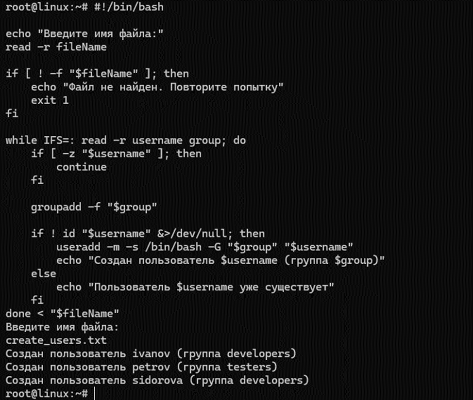

### 5.3. Запуск и проверка

```bash
chmod +x create_user.sh
sudo ./create_user.sh
id ivanov; id petrov; id sidorova
getent group developers testers
sudo ./create_user.sh
```

При запуске скрипт запрашивает имя файла (вводится `create_users.txt`). При первом запуске пользователи и группы создаются, при повторном скрипт сообщает, что пользователи уже существуют.

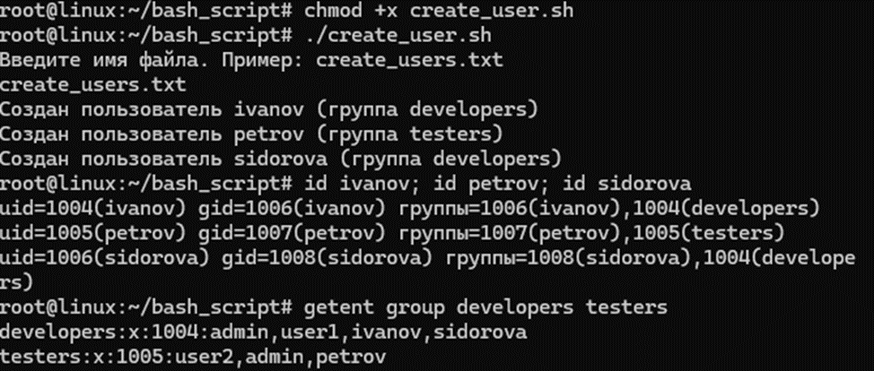

Повторный запуск:

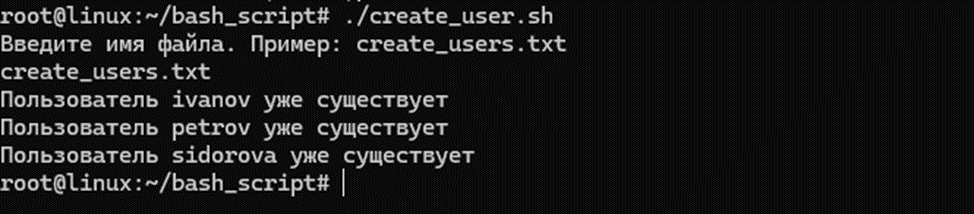

---

## Вывод

В ходе работы созданы пользователи `admin`, `user1`, `user2` и группы `developers`, `testers`, настроены права доступа к каталогам `data` и `logs`, изменён пароль `user1` и заблокирована учётная запись `user2`. Изучены команды `useradd`, `usermod`, `groupadd`, `passwd`, `chown`, `chmod`, а также `who`, `w`, `last` для мониторинга активности. Написан bash-скрипт, автоматически создающий пользователей и группы из текстового файла.
